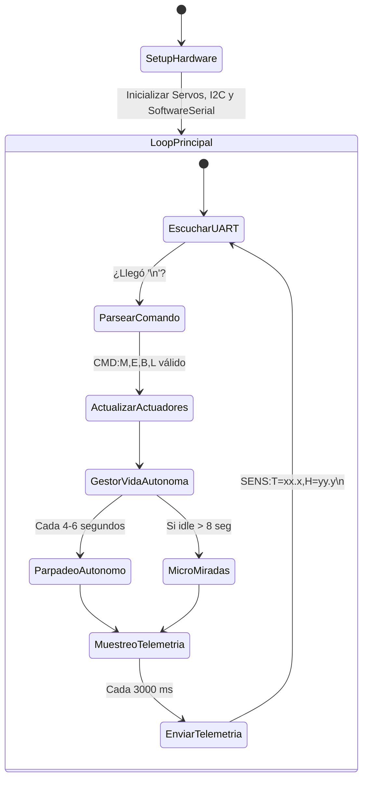

# Documento Técnico de Arquitectura y Firmware: Arduino Uno R3
**Controlador Esclavo de Tiempo Real, Telemetría y Servomotores**  
*Proyecto: Cabeza Animatrónica con IA Local · Sistemas Embebidos y Robótica*

---

## 1. Justificación Arquitectónica del Arduino Uno

En sistemas robóticos interactivos, la coexistencia de protocolos de red inalámbrica (como Wi-Fi y WebSockets) y el control de servomotores basados en modulación por ancho de pulso (PWM) genera un problema clásico de arquitectura denominado **Jitter electromecánico**. 

Las interrupciones de radiofrecuencia del chip Wi-Fi desestabilizan los temporizadores de hardware (*hardware timers*) encargados de emitir los trenes de pulsos de $50\text{ Hz}$ hacia los servos, provocando vibraciones parasitarias, calentamiento de los motores SG90 y desgaste prematuro de los engranajes.

### Decisión de Diseño:
Al delegar la totalidad del control físico al **Arduino Uno R3 (ATmega328P)**, se garantiza:
1. **Determinismo temporal absoluto:** El microcontrolador ejecuta un bucle de tiempo real sin latencias de red ni concurrencias no controladas.
2. **Vida autónoma desacoplada:** Si la red Wi-Fi se desconecta o la PC reinicia, el Arduino continúa ejecutando el parpadeo autónomo y los micromovimientos oculares para que el animatrónico no parezca "muerto".
3. **Aislamiento galvánico y de potencia:** Los sensores y actuadores se concentran en una placa con lógica de 5V robusta.

---

## 2. Mapa Oficial de Puertos y Registros de Hardware

| Puerto Físico | Registro AVR | Función en el Sistema | Tipo de Señal | Rango Seguro / Notas |
| :--- | :--- | :--- | :--- | :--- |
| **`D2`** | `PORTD2` | SoftwareSerial RX | Entrada Digital (3.3V) | Recibe tramas directas desde ESP32 `TX2` (`GPIO 17`). Nivel HIGH $>3.0\text{V}$. |
| **`D3`** | `PORTD3` | SoftwareSerial TX | Salida Digital (5.0V) | Emite telemetría hacia divisor resistivo ($1\text{ k}\Omega / 2\text{ k}\Omega$). |
| **`D4`** | `PORTD4` | Interfaz 1-Wire | E/S Digital Bidireccional | Conexión a bus de datos del sensor de humedad **DHT11**. |
| **`D7`** | `PORTD7` | Salida de Iluminación | Salida Digital (5.0V) | Conectado a resistencia de $220\,\Omega$ y LED indicador (o módulo Relé). |
| **`D9`** | `OC1A` (Timer1) | PWM Servo 1 (Ojos) | Salida PWM $50\text{ Hz}$ | Ángulo horizontal de mirada: **$60^\circ$ a $120^\circ$** ($90^\circ$ = centro). |
| **`D10`** | `OC1B` (Timer1) | PWM Servo 2 (Párpados) | Salida PWM $50\text{ Hz}$ | Apertura ocular: **$50^\circ$ (cerrado) a $100^\circ$ (abierto)** ($90^\circ$ = neutro). |
| **`D11`** | `OC2A` (Timer2) | PWM Servo 3 (Mandíbula) | Salida PWM $50\text{ Hz}$ | Modulación Lip-Sync: **$90^\circ$ (cerrada) a $130^\circ$ (apertura máxima)**. |
| **`A4`** | `PORTC4 / SDA` | Bus I2C Datos | Bidireccional Open-Drain | Línea `SDA` del sensor digital de temperatura **LM75A** (Addr `0x48`). |
| **`A5`** | `PORTC5 / SCL` | Bus I2C Reloj | Salida de Reloj Síncrono | Línea `SCL` del sensor digital de temperatura **LM75A**. |
| **`5V`** | Regulador 5V | Alimentación Lógica | $5\text{V}$ limpia ($<50\text{ mA}$) | Alimenta exclusivamente los circuitos lógicos de **LM75A** y **DHT11**. |
| **`GND`** | Plano de Tierra | Tierra de Referencia | $0\text{V}$ común | Unido físicamente al GND del ESP32 y al GND de la fuente de los servos. |

---

## 3. Estructura del Firmware y Máquina de Estados

El firmware está programado bajo un paradigma **asíncrono no bloqueante** empleando la función nativa `millis()`. Queda estrictamente prohibido el uso de la función `delay()` en el bucle principal (`loop()`), asegurando una respuesta inmediata a los comandos de modulación fonética procedentes del ESP32.

### Funciones Principales del Sketch:
1. **`leerLM75A()`:** Consulta el registro `0x00` del sensor LM75A mediante el bus I2C nativo (`Wire.h`). Extrae los 2 bytes y aplica el desplazamiento a 9 bits con factor de $0.5^\circ\text{C}$ por LSB.
2. **`parsearComando(String trama)`:** Interpreta tramas con estructura de pares clave-valor (`CMD:M=115,E=80,B=0,L=1`), valida los límites mecánicos (*clamping*) y escribe de inmediato los grados PWM en los servos correspondientes.
3. **`actualizarVidaAutonoma()`:** Genera un ciclo natural de parpadeo (cierre súbito por 140 ms y apertura elástica) cada 4 a 6 segundos mediante números pseudoaleatorios, y mueve suavemente los ojos si no hay interacción activa.
4. **`enviarTelemetria()`:** Empaqueta las variables ambientales cada 3 segundos y las transmite por `SoftwareSerial` hacia el ESP32 para que estén disponibles en el cerebro de la PC.

---

## 4. Parámetros de Calibración Mecánica y Protección de Servos

Para evitar que los dientes de nylon de los servomotores SG90 se rompan por colisión con el cráneo impreso en 3D, el firmware implementa una capa de software que acota estrictamente los ángulos de rotación:

$$\text{Ángulo Mandíbula} = \text{constrain}(M, 90^\circ, 130^\circ)$$
$$\text{Ángulo Ojos} = \text{constrain}(E, 60^\circ, 120^\circ)$$
$$\text{Ángulo Párpados} = \text{constrain}(P, 50^\circ, 100^\circ)$$

---

## 5. Instrucciones de Compilación y Carga

1. Abre el archivo [`arduino_uno_animatronico.ino`](../firmware/arduino_uno/arduino_uno_animatronico.ino) en el **Arduino IDE** (versión 2.x o superior).
2. Asegúrate de tener instaladas las siguientes librerías desde el Gestor de Librerías (*Library Manager*):
   * `Servo` (Librería nativa de Arduino).
   * `DHT sensor library` de Adafruit.
   * `Adafruit Unified Sensor`.
3. Selecciona la placa: **Tools $\to$ Board $\to$ Arduino AVR Boards $\to$ Arduino Uno**.
4. Selecciona el puerto COM correspondiente a tu placa Arduino Uno.
5. Haz clic en **Upload** (Subir). Abre el Monitor Serial a **115200 baudios** para verificar los mensajes de diagnóstico iniciales.

