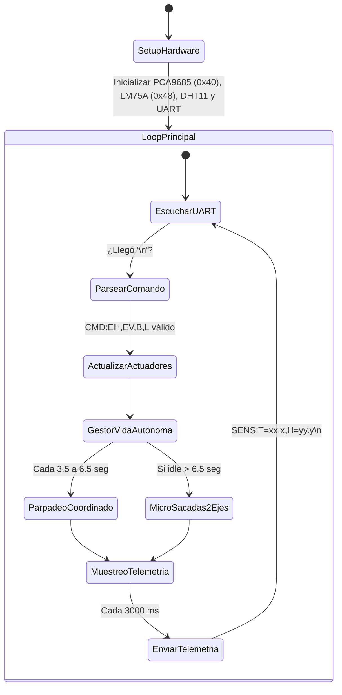

# Documento Técnico de Arquitectura y Firmware: Arduino Uno R3
**Controlador Esclavo de Tiempo Real, Telemetría I2C y Servomotores (Mecanismo Ocular ε3.2 con PCA9685)**  
*Proyecto: Cabeza Animatrónica con IA Local · Sistemas Embebidos y Robótica*

---

## 1. Justificación Arquitectónica del Arduino Uno y PCA9685

En sistemas robóticos interactivos, la coexistencia de protocolos de red inalámbrica (como Wi-Fi y WebSockets) y el control de servomotores basados en modulación por ancho de pulso (PWM) genera un problema clásico de arquitectura denominado **Jitter electromecánico**. 

Las interrupciones de radiofrecuencia del chip Wi-Fi desestabilizan los temporizadores de hardware (*hardware timers*) encargados de emitir los trenes de pulsos de $50\text{ Hz}$ hacia los servos, provocando vibraciones parasitarias, calentamiento de los motores SG90/MG90S y desgaste prematuro de los engranajes.

### Decisión de Diseño:
Al delegar la totalidad del control físico al **Arduino Uno R3 (ATmega328P)** y desacoplar la generación PWM a un controlador dedicado **PCA9685 por I2C**, se garantiza:
1. **Determinismo temporal absoluto:** El microcontrolador no sufre sobrecarga de temporizadores para 6 canales PWM simultáneos. El chip PCA9685 genera trenes de pulsos de 12 bits de resolución a $50\text{ Hz}$ mediante su propio oscilador interno de $25\text{ MHz}$, gobernando los 6 servomotores del mecanismo ocular ε3.2 de Will Cogley ([MakerWorld #1184807](https://makerworld.com/es/models/1184807-animatronic-eye-mechanism-e3-2#profileId-1195681)).
2. **Audio Delegado al Smartphone (Modo Asistente Manos Libres):** El teléfono móvil cumple el rol de nodo transductor de voz (micrófono continuo para palabra clave "Oye Robot" / "Alexa" y altavoz para síntesis vocal Loquendo). Esto elimina la necesidad de módulos de audio cableados en la placa, liberando por completo los pines **`D10`** y **`D11`** del Arduino Uno para futuras expansiones.
3. **Vida autónoma desacoplada:** Si la red Wi-Fi se desconecta o la PC reinicia, el Arduino continúa ejecutando el parpadeo autónomo y las microsacadas oculares en 2 ejes para que el animatrónico conserve naturalidad.
4. **Aislamiento galvánico y de potencia:** La alimentación de los servomotores se toma íntegramente desde la bornera `V+` y `GND` del PCA9685, conectada directamente a una fuente externa regulada de $5\text{V } 4\text{A}$ con desacoplo electrolítico de $2200\,\mu\text{F}$ y cerámico de $100\text{ nF}$.

---

## 2. Mapa Oficial de Puertos y Registros de Hardware

### Arduino Uno R3 (Maestro I2C y Enlaces Seriales)

| Puerto Físico | Registro AVR | Actuador / Función en el Sistema | Tipo de Señal | Rango Seguro / Notas |
| :--- | :--- | :--- | :--- | :--- |
| **`D2`** | `PORTD2` | SoftwareSerial RX (Enlace ESP32) | Entrada Digital (3.3V) | Recibe tramas directas desde ESP32 `TX2` (`GPIO 17`). Nivel HIGH $>3.0\text{V}$. |
| **`D3`** | `PORTD3` | SoftwareSerial TX (Enlace ESP32) | Salida Digital (5.0V) | Emite telemetría hacia divisor resistivo ($1\text{ k}\Omega / 2\text{ k}\Omega$) hacia `GPIO 16`. |
| **`D4`** | `PORTD4` | Interfaz 1-Wire | E/S Digital Bidireccional | Conexión a bus de datos del sensor de humedad **DHT11**. |
| **`D7`** | `PORTD7` | Salida de Iluminación | Salida Digital (5.0V) | Conectado a resistencia de $220\,\Omega$ y LED indicador (o módulo Relé). |
| **`D10`** | `PORTB2` | Pin Libre / Expansión | Sin Conexión (NC) | Liberado. Audio procesado de forma inalámbrica por Smartphone. |
| **`D11`** | `PORTB3` | Pin Libre / Expansión | Sin Conexión (NC) | Liberado. Audio procesado de forma inalámbrica por Smartphone. |
| **`A4`** | `PORTC4 / SDA` | Bus I2C Datos | Bidireccional Open-Drain | Línea `SDA` compartida entre **LM75A** (`0x48`) y **PCA9685** (`0x40`). |
| **`A5`** | `PORTC5 / SCL` | Bus I2C Reloj | Salida de Reloj Síncrono | Línea `SCL` compartida entre **LM75A** (`0x48`) y **PCA9685** (`0x40`). |
| **`5V`** | Regulador 5V | Alimentación Lógica Sensores | $5\text{V}$ limpia ($<50\text{ mA}$) | Alimenta exclusivamente la lógica de **LM75A**, **DHT11** y **VCC lógica de PCA9685**. |
| **`GND`** | Plano de Tierra | Tierra de Referencia | $0\text{V}$ común | Riel común unido al GND del ESP32 y polo negativo de la fuente externa 5V 4A. |

### Controlador PCA9685 (I2C: 0x40 - 16 Canales PWM)

| Canal | Actuador / Articulación ε3.2 | Rango Angular Seguro | Configuración de Pulso (12-bit) | Función Mecánica |
| :--- | :--- | :--- | :--- | :--- |
| **`CH0`** | Servo M1: Ojos Horizontal (Pan / Yaw) | **$60^\circ$ a $120^\circ$** ($90^\circ$ neutro) | ~180 a ~420 LSB | Mecanismo de 4 barras: giro sincrónico izq/der de ambos ojos. |
| **`CH1`** | Servo M2: Ojos Vertical (Tilt / Pitch) | **$70^\circ$ a $110^\circ$** ($90^\circ$ neutro) | ~200 a ~400 LSB | Varilla y rótula universal: elevación y descenso de la mirada. |
| **`CH2`** | Servo M3: Párpado Superior Izquierdo | **$45^\circ$ (Cerrado) a $100^\circ$ (Abierto)** | ~150 a ~380 LSB | Parpadeo, guiño y apertura del párpado superior izquierdo. |
| **`CH3`** | Servo M4: Párpado Inferior Izquierdo | **$80^\circ$ (Reposo) a $110^\circ$ (Elevado)** | ~220 a ~390 LSB | Elevación inferior para gestos de sonrisa y concentración. |
| **`CH4`** | Servo M5: Párpado Superior Derecho | **$45^\circ$ (Cerrado) a $100^\circ$ (Abierto)** | ~150 a ~380 LSB | Parpadeo, guiño y apertura del párpado superior derecho. |
| **`CH5`** | Servo M6: Párpado Inferior Derecho | **$80^\circ$ (Reposo) a $110^\circ$ (Elevado)** | ~220 a ~390 LSB | Elevación inferior para gestos anatómicos realistas. |
| **`CH6-15`** | Libres | - | - | Canales disponibles para ampliaciones (cuello, cejas, etc.). |

---

## 3. Estructura del Firmware y Máquina de Estados

El firmware está programado bajo un paradigma **asíncrono no bloqueante** empleando la función nativa `millis()`. Queda estrictamente prohibido el uso de la función `delay()` en el bucle principal (`loop()`), asegurando una respuesta inmediata a los comandos de movimiento procedentes del ESP32.

### Funciones Principales del Sketch:
1. **`readLM75A()`:** Consulta el registro `0x00` del sensor LM75A mediante el bus I2C nativo (`Wire.h`). Extrae los 2 bytes y aplica el desplazamiento a 9 bits con factor de $0.5^\circ\text{C}$ por LSB.
2. **`setServoAngle(channel, angle)`:** Convierte el ángulo en grados ($0^\circ$ a $180^\circ$) al valor de pulso PWM de 12 bits ($0$ a $4095$) para el PCA9685 y lo escribe a través de `pca.setPWM()`.
3. **`processCommand(String trama)`:** Interpreta tramas con pares clave-valor (`CMD:EH=85,EV=95,B=0,L=1`), valida los límites mecánicos del mecanismo ε3.2 (*clamping*), actualiza los servos y enciende o apaga la luz indicadora.
4. **`updateAutonomy()`:** Genera un ciclo natural de parpadeo coordinado (cierre simultáneo por 140 ms de CH2/CH4 y elevación de CH3/CH5) cada 3.5 a 6.5 segundos mediante números pseudoaleatorios, y ejecuta sacadas oculares en 2 ejes (CH0/CH1) cuando no hay comandos activos.
5. **`sendTelemetry()`:** Empaqueta las variables ambientales cada 3 segundos y las transmite por `SoftwareSerial` hacia el ESP32.

---

## 4. Parámetros de Calibración Mecánica y Protección de Servos

Para evitar que los engranajes plásticos o metálicos de los micro-servos se dañen por colisión mecánica con el chasis impreso en 3D del mecanismo ε3.2, el firmware implementa límites estrictos:

$$\text{Ángulo Ojos Pan (CH0)} = \text{constrain}(EH, 60^\circ, 120^\circ)$$
$$\text{Ángulo Ojos Tilt (CH1)} = \text{constrain}(EV, 70^\circ, 110^\circ)$$
$$\text{Ángulo Párpados Superiores (CH2, CH4)} = \text{constrain}(P_{sup}, 45^\circ, 100^\circ)$$
$$\text{Ángulo Párpados Inferiores (CH3, CH5)} = \text{constrain}(P_{inf}, 80^\circ, 110^\circ)$$

---

## 5. Instrucciones de Compilación y Carga

1. Abre el archivo [`arduino_uno_animatronico.ino`](../firmware/arduino_uno/arduino_uno_animatronico.ino) en el **Arduino IDE** (versión 2.x o superior).
2. Asegúrate de tener instaladas las siguientes librerías desde el Gestor de Librerías (*Library Manager*):
   * `Adafruit PWM Servo Driver Library` de Adafruit.
   * `DHT sensor library` de Adafruit.
   * `Adafruit Unified Sensor`.
   * `Wire` (nativa).
   * `SoftwareSerial` (nativa).
3. Selecciona la placa: **Tools $\to$ Board $\to$ Arduino AVR Boards $\to$ Arduino Uno**.
4. Selecciona el puerto COM correspondiente a tu placa Arduino Uno.
5. Haz clic en **Upload** (Subir). Abre el Monitor Serial a **115200 baudios** para verificar los mensajes de diagnóstico iniciales (`PCA9685 inicializado en 0x40`).
