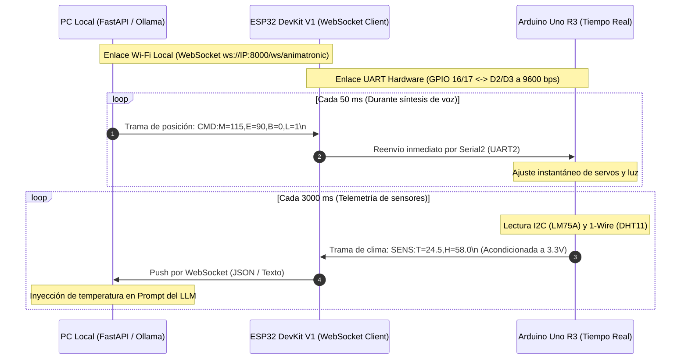

# Documento Técnico de Arquitectura y Firmware: ESP32 DevKit V1
**Pasarela Inalámbrica de Alta Velocidad (Wi-Fi WebSocket ↔ Hardware UART2)**  
*Proyecto: Cabeza Animatrónica con IA Local · Sistemas Embebidos y Robótica*

---

## 1. Justificación Arquitectónica del ESP32 DevKit V1

El microcontrolador **ESP32 (Tensilica Xtensa Dual-Core 32-bit LX6)** actúa como el **Maestro de Comunicaciones Inalámbricas** del proyecto. Posee la pila de red TCP/IP acelerada por hardware, lo que permite sostener enlaces WebSocket con latencias inferiores a $5\text{ ms}$.

### Decisión de Especialización Funcional:
Al liberar al ESP32 de la generación de señales PWM para los servomotores y de la lectura directa de los sensores físicos, se consiguen tres ventajas determinantes:
1. **Memoria RAM disponible al 85%:** Los 520 KB de SRAM permanecen disponibles para gestionar búferes de red, retransmisiones automáticas y cifrado sin riesgo de desbordamiento (*heap exhaustion*).
2. **Cero degradación de red:** Las ráfagas de paquetes de audio o comandos provenientes del servidor en la PC no interfieren con la mecánica del animatrónico.
3. **Aislamiento de tareas mediante Hardware UART2:** La comunicación con el Arduino Uno se realiza a través de un periférico UART de silicio dedicado (`Serial2`), el cual no consume ciclos de CPU gracias a sus colas FIFO internas de 128 bytes.

---

## 2. Mapa Oficial de Puertos y Niveles Lógicos

| Pin ESP32 | Nombre de Función | Conexión Física | Dirección de Señal | Nivel de Tensión / Advertencia |
| :--- | :--- | :--- | :--- | :--- |
| **`GPIO 17`** | `U2TXD` (UART2 TX) | Directo a **Arduino Pin `D2`** | Salida Digital | **3.3V Nativo:** El microcontrolador ATmega328P del Arduino detecta con total fiabilidad cualquier tensión mayor a 3.0V como nivel alto (`HIGH`). |
| **`GPIO 16`** | `U2RXD` (UART2 RX) | Nodo central del **Divisor Resistivo** | Entrada Digital | **3.33V Acondicionado:** Recibe la señal de transmisión de 5V del Arduino atenuada por las resistencias de $1\text{ k}\Omega$ y $2\text{ k}\Omega$. **Prohibido conectar 5V directo**. |
| **`GPIO 2`** | `LED_BUILTIN` | LED azul en placa | Salida Digital | Indicador visual de estado de red (parpadeo = conectando, fijo = WebSocket enlazado). |
| **`GND`** | Tierra | Riel negativo protoboard | Referencia Común | **Unión obligatoria de tierras** con el Arduino Uno y la fuente externa de 5V. |
| **`VIN`** | Entrada Regulador | Conector Micro-USB (PC/Cargador) | Alimentación 5V | Regulador LDO AMS1117-3.3 integrado suministra los 3.3V al chip de radio. |

---

## 3. Circuito Divisor de Voltaje de Protección en GPIO 16

El SoC ESP32 no tolera 5V en sus compuertas GPIO. Exceder los $3.6\text{V}$ destruye permanentemente el circuito de entrada del periférico UART. El circuito implementado garantiza una atenuación matemática perfecta:

```
        [Arduino Pin D3 (SoftwareSerial TX - 5.0V)]
                           |
                           |
                         [1 kΩ]  (R1)
                           |
                           +------------------------> [ESP32 GPIO 16 (RX2)] (~3.33V SEGURO)
                           |
                         [2 kΩ]  (R2: o 2.2 kΩ)
                           |
                           |
                    [GND Común (0V)]
```

### Cálculo de Validación:
$$V_{\text{ESP32\_RX}} = V_{\text{Arduino\_TX}} \cdot \left( \frac{R_2}{R_1 + R_2} \right) = 5.0\text{V} \cdot \left( \frac{2000\,\Omega}{1000\,\Omega + 2000\,\Omega} \right) = 5.0\text{V} \cdot \frac{2}{3} \approx 3.333\text{V}$$

---

## 4. Diagrama de Flujo de Datos Bidireccional



---

## 5. Instrucciones de Compilación y Flasheo

1. Abre el archivo [`esp32_puente_websocket.ino`](../firmware/esp32_devkit/esp32_puente_websocket.ino) en el **Arduino IDE**.
2. Instala la librería **`WebSockets`** de Markus Sattler (`Links2004/arduinoWebSockets`) desde el Gestor de Librerías del Arduino IDE.
3. Asegúrate de tener instalado el paquete de placas **`esp32`** de Espressif Systems en el Gestor de Tarjetas.
4. Selecciona la placa: **Tools $\to$ Board $\to$ ESP32 Arduino $\to$ DOIT ESP32 DEVKIT V1** (o tu modelo específico de 30/38 pines).
5. Configura los parámetros de compilación:
   * **Upload Speed:** `921600` (o `115200` si tu cable USB es largo).
   * **CPU Frequency:** `240MHz (WiFi/BT)`.
   * **Flash Frequency:** `80MHz`.
6. En el sketch, ingresa el **SSID** y **Password** de tu red Wi-Fi local, así como la **Dirección IP de tu PC**.
7. Presiona el botón **Upload**. *(Si el cargador se queda en `Connecting......`, mantén presionado el botón `BOOT` de la placa ESP32 por 2 segundos hasta que comience el flasheo).*

