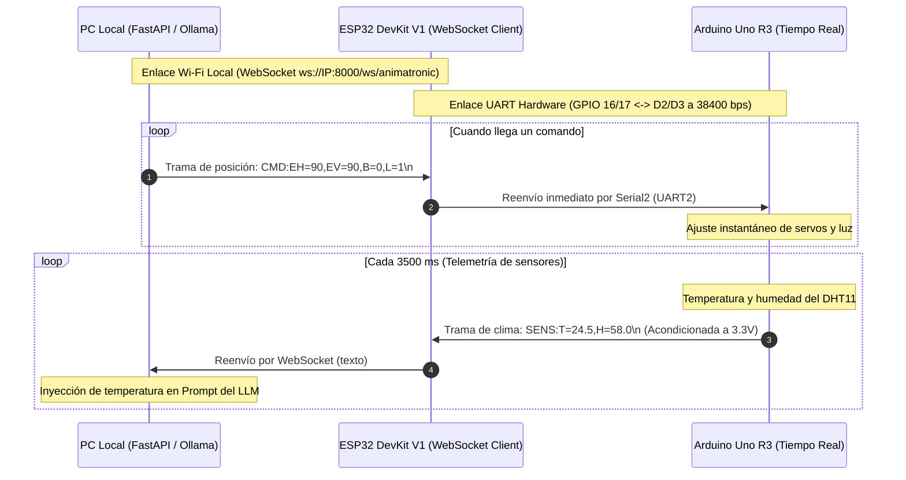

# Documento Técnico de Arquitectura y Firmware: ESP32 DevKit V1
**Pasarela Inalámbrica de Alta Velocidad (Wi-Fi WebSocket ↔ Hardware UART2)**  
*Proyecto: Cabeza Animatrónica con IA Local · Sistemas Embebidos y Robótica*

El [cableado y la puesta en marcha](GUIA_ARMADO_EYEMECH.md) describen la conexión del ESP32 al Uno y la configuración Wi-Fi.

---

## 1. Justificación Arquitectónica del ESP32 DevKit V1

El ESP32 conecta la PC por WebSocket y el Uno por UART2. El Uno conserva el control de servos y sensores. El ESP32 retiene la posición de seguimiento más reciente y reenvía por separado las órdenes de luz y parpadeo.

---

## 2. Mapa Oficial de Puertos y Niveles Lógicos

| Pin ESP32 | Nombre de Función | Conexión Física | Dirección de Señal | Nivel de Tensión / Advertencia |
| :--- | :--- | :--- | :--- | :--- |
| **`GPIO 17`** | `U2TXD` (UART2 TX) | A **Arduino D2** a través de un adaptador de 3,3 V a 5 V | Salida Digital | Usa el circuito de la guía de armado. |
| **`GPIO 16`** | `U2RXD` (UART2 RX) | Nodo central del **Divisor Resistivo** | Entrada Digital | **3.33V Acondicionado:** Recibe la señal de transmisión de 5V del Arduino atenuada por las resistencias de $1\text{ k}\Omega$ y $2\text{ k}\Omega$. **Prohibido conectar 5V directo**. |
| **`GPIO 2`** | `LED_BUILTIN` | LED azul en placa | Salida Digital | Indicador visual de estado de red (parpadeo = conectando, fijo = WebSocket enlazado). |
| **`GND`** | Tierra | Riel negativo protoboard | Referencia Común | **Unión obligatoria de tierras** con el Arduino Uno y la fuente externa de 5V. |
| **`VIN`** | Entrada Regulador | Conector Micro-USB (PC/Cargador) | Alimentación 5V | Regulador LDO AMS1117-3.3 integrado suministra los 3.3V al chip de radio. |

---

## 3. Circuito Divisor de Voltaje de Protección en GPIO 16

La entrada UART del ESP32 trabaja a 3,3 V. El divisor atenúa el nivel alto de D3 antes de GPIO16.

```
        [Arduino Pin D3 (SoftwareSerial TX - 5.0V)]
                           |
                           |
                         [1 kΩ]  (R1)
                           |
                           +------------------------> [ESP32 GPIO 16 (RX2)] (~3.33V SEGURO)
                           |
                         [2 kΩ]  (R2)
                           |
                           |
                    [GND Común (0V)]
```

### Cálculo de Validación:
$$V_{\text{ESP32\_RX}} = V_{\text{Arduino\_TX}} \cdot \left( \frac{R_2}{R_1 + R_2} \right) = 5.0\text{V} \cdot \left( \frac{2000\,\Omega}{1000\,\Omega + 2000\,\Omega} \right) = 5.0\text{V} \cdot \frac{2}{3} \approx 3.333\text{V}$$

---

## 4. Diagrama de Flujo de Datos Bidireccional



---

## 5. Instrucciones de Compilación y Flasheo

1. Abre el archivo [`esp32_puente_websocket.ino`](../firmware/esp32_puente_websocket/esp32_puente_websocket.ino) en el **Arduino IDE**.
2. Instala la librería **`WebSockets`** de Markus Sattler (`Links2004/arduinoWebSockets`) desde el Gestor de Librerías del Arduino IDE.
3. Asegúrate de tener instalado el paquete de placas **`esp32`** de Espressif Systems en el Gestor de Tarjetas.
4. Selecciona la placa: **Tools $\to$ Board $\to$ ESP32 Arduino $\to$ DOIT ESP32 DEVKIT V1** (o tu modelo específico de 30/38 pines).
5. Configura los parámetros de compilación:
   * **Upload Speed:** `921600` (o `115200` si tu cable USB es largo).
   * **CPU Frequency:** `240MHz (WiFi/BT)`.
   * **Flash Frequency:** `80MHz`.
6. Copia el ejemplo local a `wifi_config.h` y configura el SSID, la clave Wi-Fi y la IPv4 LAN de la PC.
7. Presiona el botón **Upload**. *(Si el cargador se queda en `Connecting......`, mantén presionado el botón `BOOT` de la placa ESP32 por 2 segundos hasta que comience el flasheo).*

