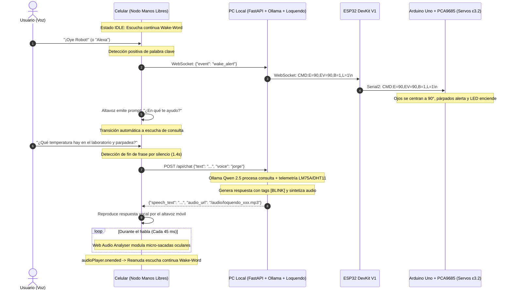

# Documento Técnico: Aplicación Móvil y Servidor Central en PC
**Celular como Nodo Transductor de Voz Manos Libres Tipo Alexa (Micrófono Continuo, Altavoz y WakeNet con IA Local)**  
*Proyecto: Cabeza Animatrónica con IA Local · Sistemas Embebidos y Robótica*

---

## 1. Justificación y Mecanismo Operativo del Celular

En proyectos de robótica convencional, incorporar capacidades de audio inalámbrico suele demandar módulos costosos y de difícil calibración: micrófonos I2S digitales (como INMP441), decodificadores MP3/WAV (DFPlayer Mini / VS1053) y amplificadores de audio con bocinas dedicadas, además de lidiar con ruidos parásitos de conmutación causados por los motores.

### La Solución Arquitectónica:
El **Smartphone** funciona como un **nodo transductor de audio inalámbrico manos libres ("Headless Voice Node")**:
1. **Sin Interacción con la Pantalla:** El usuario no necesita tocar la pantalla del teléfono durante la sesión. El dispositivo permanece colocado en la mesa o soporte acústico actuando como un asistente inteligente tipo Amazon Alexa o Google Nest.
2. **Escucha Continua con Detección de Activación (Wake-Word / WakeNet):**
   - El micrófono se mantiene en escucha pasiva continua reconociendo patrones fonéticos clave en español (`"Oye Robot"`, `"Hola Robot"`, `"Alexa"`, `"Robot"`, `"Animatrónico"`).
   - Al detectar la palabra clave:
     - El celular emite vocalmente de forma instantánea el saludo de atención: **"¿En qué te ayudo?"** por su altavoz.
     - Envía un evento WebSocket prioritario (`wake_alert`) al servidor central, ordenando a la cabeza animatrónica mirar al frente a $90^\circ$, abrir párpados y encender la luz indicadora (**Pin D7**).
     - Entra en modo de captura activa de la orden del usuario con detección automática de pausas y silencios (VAD / Speech End).
3. **Altavoz Inalámbrico con Voces de Loquendo / Voicebox:**
   - La respuesta generada por **Ollama (Qwen 2.5)** se sintetiza en la PC y se reproduce a través del altavoz integrado del smartphone.
   - Al finalizar la reproducción del audio (`onended`), el celular regresa de forma automática e infinita al estado de escucha pasiva de la palabra clave, cerrando el ciclo autónomo.

---

## 2. Diagrama de Flujo de Interacción Celular ↔ PC ↔ ESP32 (Modo Alexa)



---

## 3. Características de la Interfaz Web Móvil

* **Modo Manos Libres Autónomo:** Indicador dinámico de estado (*Esperando palabra clave* -> *Activado* -> *Escuchando consulta* -> *Procesando IA* -> *Hablando por altavoz*).
* **Cero Contacto Físico:** Tras desbloquear la sesión de audio inicial con un toque, el ciclo opera 100% por voz.
* **Túnel Seguro Cloudflare HTTPS Integrado:** Genera automáticamente un enlace seguro temporal (`https://*.trycloudflare.com`) para que Safari en iPhone y Chrome en Android permitan el uso prolongado del micrófono sin bloqueos.
* **Telemetría en Vivo:**
  * Temperatura ambiente en tiempo real (sensor digital **LM75A** por bus I2C `0x48`).
  * Humedad relativa (sensor **DHT11** por pin `D4`).
  * Control del LED de laboratorio (**Pin D7**).
  * Monitoreo de latencia de Ollama (`qwen2.5`) y enlace ESP32 DevKit V1.

---

## 4. Instrucciones para Ejecutar

### Paso 1: Iniciar el Servidor en tu PC
Ejecuta en tu terminal:

```bash
cd server_pc
python run_server.py
```

### Paso 2: Conectar el Celular
1. Escanea el código QR que aparece en la consola de la PC para abrir la interfaz en el navegador del teléfono.
2. Toca el botón **"Iniciar Manos Libres"** en la pantalla del celular una sola vez para autorizar el micrófono y el altavoz.
3. Deja el teléfono sobre la mesa cerca de la cabeza animatrónica. Di en voz alta: **"Oye Robot"** o **"Alexa"**.
4. El celular responderá de inmediato: **"¿En qué te ayudo?"** y la cabeza robótica centrará su mirada y encenderá la luz.
5. Formula tu pregunta directamente sin tocar el teléfono. Escucharás la respuesta por el altavoz del celular y el robot reanudará la escucha continua automáticamente al terminar.
