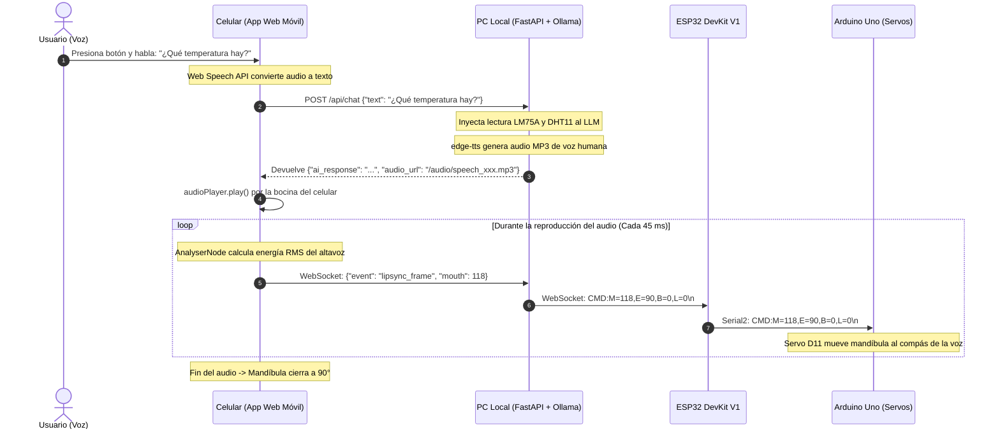

# Documento Técnico: Aplicación Móvil y Servidor Central en PC
**Celular como Micrófono Inalámbrico, Altavoz y Analizador de Sincronización Labial**  
*Proyecto: Cabeza Animatrónica con IA Local · Sistemas Embebidos y Robótica*

---

## 1. Justificación y Mecanismo Operativo del Celular

En proyectos de robótica convencional, incorporar capacidades de audio inalámbrico suele demandar módulos costosos y de difícil calibración: micrófonos I2S digitales (como INMP441), decodificadores MP3/WAV (DFPlayer Mini / VS1053) y amplificadores de audio con bocinas dedicadas, además de lidiar con ruidos parásitos de conmutación causados por los motores.

### La Solución Arquitectónica:
Se aprovecha el **Smartphone que ya posees** (conectado a la misma red local Wi-Fi que la PC) para cumplir una doble función sin costo adicional de hardware:
1. **Micrófono Inalámbrico de Alta Fidelidad:** Utiliza el hardware de reducción de ruido integrado en el teléfono y la **Web Speech API** nativa de Android/iOS para transcribir la voz del usuario a texto con cero latencia.
2. **Altavoz Inalámbrico con Lip-Sync Dinámico:** Reproduce la voz sintetizada de la IA generada por la PC y, mediante la **Web Audio API (`AnalyserNode`)**, calcula en tiempo real ($60\text{ fps}$) la energía de las frecuencias fonéticas para transmitir los ángulos de apertura de la mandíbula al ESP32 y Arduino.

---

## 2. Diagrama de Flujo de Interacción Celular ↔ PC ↔ ESP32



---

## 3. Características de la Interfaz Web Móvil

* **Diseño Nativo Táctil:** Optimizada para no requerir instalación de APKs pesadas; funciona directo desde Google Chrome o Safari móvil.
* **Simulador Facial en Tiempo Real:** Cuenta con una cara robótica virtual que parpadea, rastrea con la pupila y mueve su mandíbula en pantalla simultáneamente con el robot físico.
* **Telemetría en Vivo:**
  * Badge de temperatura digital en tiempo real (procedente del **LM75A** por bus I2C).
  * Badge de humedad relativa (procedente del **DHT11**).
  * Botón háptico para encender/apagar la luz del laboratorio (**Pin D7** del Arduino).
  * Indicador de pulso verde de conexión del ESP32.
* **Panel de Calibración Desplegable:** Permite mover con barras deslizadoras (*sliders*) los ojos y la mandíbula para probar los servos SG90 manualmente.

---

## 4. Instrucciones para Ejecutar y Conectar tu Celular

### Paso 1: Iniciar el Servidor en tu PC
Abre una terminal PowerShell en tu computadora dentro de la carpeta del proyecto y ejecuta:

```bash
cd server_pc
python run_server.py
```

### Paso 2: Conectar el Celular
1. Asegúrate de que tu celular esté conectado a la **misma red Wi-Fi** que tu computadora.
2. En la terminal de la PC verás una dirección como:
   $$\text{http://192.168.0.3:8000}$$
   junto con un **código QR generado en la terminal**.
3. **Abre la cámara de tu celular y escanea el código QR** (o escribe la dirección directamente en Chrome / Safari).

### Paso 3: Interactuar
* Toca el **botón circular del micrófono** en la pantalla del celular y hazle cualquier pregunta.
* Escucharás la respuesta por el altavoz de tu teléfono mientras la mandíbula física del animatrónico se mueve al ritmo de cada palabra.

