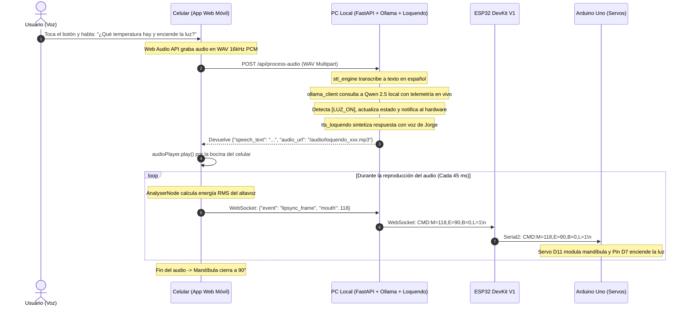

# Documento Técnico: Aplicación Móvil y Servidor Central en PC
**Celular como Micrófono Inalámbrico, Altavoz y Analizador de Sincronización Labial con Loquendo e IA Local**  
*Proyecto: Cabeza Animatrónica con IA Local · Sistemas Embebidos y Robótica*

---

## 1. Justificación y Mecanismo Operativo del Celular

En proyectos de robótica convencional, incorporar capacidades de audio inalámbrico suele demandar módulos costosos y de difícil calibración: micrófonos I2S digitales (como INMP441), decodificadores MP3/WAV (DFPlayer Mini / VS1053) y amplificadores de audio con bocinas dedicadas, además de lidiar con ruidos parásitos de conmutación causados por los motores.

### La Solución Arquitectónica:
Se aprovecha el **Smartphone que ya posees** (conectado a la misma red local Wi-Fi que la PC o mediante túnel seguro HTTPS) para cumplir una doble función sin costo adicional de hardware:
1. **Micrófono Inalámbrico de Alta Fidelidad:**
   - **Grabación Directa Web Audio (16kHz PCM WAV):** Captura el flujo de audio puro del micrófono del celular sin compresión ruidosa, lo envía al endpoint `/api/process-audio` de la PC y se transcribe en el servidor mediante el motor STT (Google Speech Recognition en español). Esta arquitectura garantiza compatibilidad total en iPhone (iOS Safari) y Android (Chrome), superando las limitaciones y bloqueos de las APIs de reconocimiento nativas de navegador.
   - **Visualizador de Forma de Onda en Tiempo Real:** Un canvas dinámico muestra las oscilaciones de tu voz mientras hablas.
2. **Altavoz Inalámbrico con Voces de Loquendo y Lip-Sync Dinámico:**
   - Reproduce la voz sintetizada de la legendaria voz de **Loquendo** (Jorge de España, Carlos de Latinoamérica o Carmen).
   - Incluye motor de caché en disco (`audio/`) basado en hashes MD5 para respuestas instantáneas en consultas frecuentes.
   - Mediante la **Web Audio API (`AnalyserNode`)**, calcula en tiempo real ($60\text{ fps}$) la envolvente fonética para transmitir los ángulos de apertura de la mandíbula al ESP32 y Arduino.

---

## 2. Diagrama de Flujo de Interacción Celular ↔ PC ↔ ESP32



---

## 3. Características de la Interfaz Web Móvil

* **Diseño Nativo Táctil:** Optimizada para no requerir instalación de APKs pesadas; funciona directo desde Google Chrome o Safari móvil.
* **Selector de Voz en Vivo:** Permite alternar entre **Jorge (España)**, **Carlos (Latinoamérica)** y **Carmen (España)**.
* **Túnel Seguro Cloudflare HTTPS Integrado:** Genera automáticamente un enlace seguro temporal (`https://*.trycloudflare.com`) para que Safari en iPhone y Chrome en Android otorguen permisos de micrófono sin advertencias de certificado ni restricciones de red.
* **Simulador Facial en Tiempo Real:** Cuenta con una cara robótica virtual que parpadea autónomamente, rastrea con la pupila y modula su mandíbula en pantalla simultáneamente con el robot físico.
* **Telemetría en Vivo:**
  * Badge de temperatura digital en tiempo real (procedente del sensor digital **LM75A** por bus I2C).
  * Badge de humedad relativa (procedente del sensor **DHT11**).
  * Botón háptico para encender/apagar la luz del laboratorio (**Pin D7** del Arduino).
  * Indicador de pulso verde de conexión del ESP32 y estado de Ollama (`qwen2.5:7b`).
* **Panel de Calibración Desplegable:** Permite mover con barras deslizadoras (*sliders*) los ojos y la mandíbula para probar los servos SG90 manualmente.

---

## 4. Instrucciones para Ejecutar y Conectar tu Celular

### Paso 1: Iniciar el Servidor en tu PC
Abre una terminal PowerShell en la raíz del proyecto o haz doble clic en **`start.bat`**:

```bash
.\start.bat
# o directamente con python:
cd server_pc
python run_server.py
```

### Paso 2: Conectar el Celular
1. El servidor mostrará en la consola dos opciones de conexión junto a un **código QR**:
   - **Enlace HTTPS (Recomendado):** Ideal para iPhones y celulares modernos donde las políticas de seguridad requieren HTTPS para el micrófono.
   - **Enlace Local Wi-Fi:** `http://192.168.x.x:8000` (para usar dentro de la misma red local).
2. **Abre la cámara de tu celular y escanea el código QR**.

### Paso 3: Interactuar
* Toca el **botón circular del micrófono** en la pantalla del celular y habla tu pregunta.
* Vuelve a tocar el botón para enviar el audio.
* **Qwen 2.5** responderá en tiempo real desde tu PC y escucharás a **Jorge de Loquendo** hablando por el altavoz de tu celular mientras el animatrónico mueve su mandíbula.
